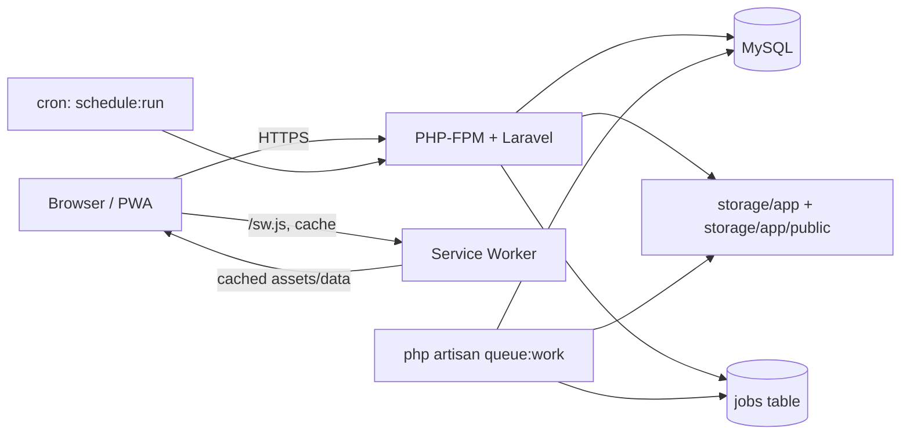
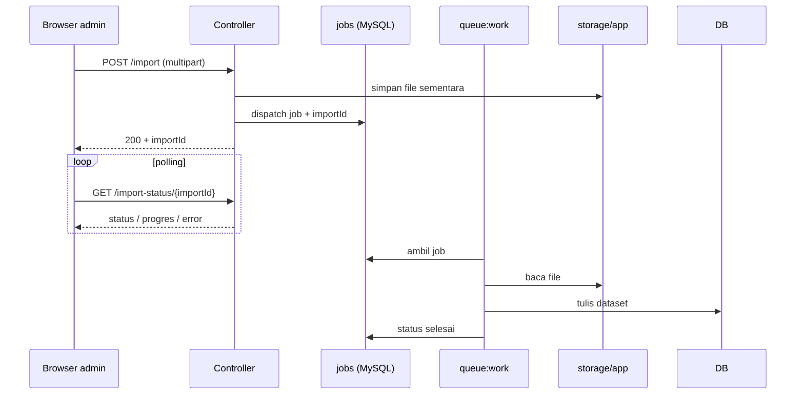

# Arsitektur aplikasi

## Gambaran umum

Aplikasi ini adalah monolayer Laravel 10 yang merender Blade + CoreUI, dengan beberapa endpoint JSON untuk DataTables dan polling status import. Tidak ada microservice. Database MySQL menyimpan data bisnis, antrean job, session, dan activity log. File yang diunggah dan PDF revisi BOM disimpan di filesystem lokal.

## Lapisan kode

| Lapisan | Lokasi | Tanggung jawab |
| --- | --- | --- |
| Route | `routes/web.php`, `routes/api.php` | Pemetaan URL, grup middleware `auth`, `auth.active`, `role:admin`, throttle |
| Middleware | `app/Http/Middleware/` | Autentikasi, status aktif user, CSRF, trim, request ID idempotensi |
| Controller | `app/Http/Controllers/` | Validasi request, orchestrasi, response JSON/Blade |
| Service / Support | `app/Services/`, `app/Support/` | Pemrosesan data Excel, mapper kolom, import tracker, activity logger |
| Job | `app/Jobs/` | Import file di latar belakang |
| Import / Export | `app/Imports/`, `app/Exports/` | Maatwebsite Excel concerns |
| Model | `app/Models/` | Eloquent, relasi, aksesor/cast |
| Provider | `app/Providers/` | Fortify, event listener, observer pendaftaran, route |
| View | `resources/views/` | Blade layout CoreUI, komponen monitoring, halaman admin |
| Frontend | `resources/js/`, `resources/css/`, `public/js/` | Vite bundle, modul offline, skrip DataTables per halaman |

`AppServiceProvider::boot()` secara dinamis mendaftarkan `GlobalObserverActivityLogs` ke semua kelas Eloquent yang ada di `app/Models`. Model baru di folder tersebut otomatis diaudit tanpa perubahan provider.

## Dua domain utama

### Material Planning

- Entry point: `SapDatasetController@index` di `/material-planning`.
- Data dibaca lewat `GET /material-planning/data` (DataTables server-side) dan diekspor lewat `/material-planning/export`.
- Tulis data dilakukan admin lewat import Excel rekap kebutuhan (langsung di request); penghapusan data rekap memakai `/reset-data`.
- Model utama: `DaftarKebutuhanMaterial`, dengan `Project` dan `Oka` sebagai data pendukung. Hubungan antaranya berupa kolom kode/proyek yang di-join di query, bukan foreign key fisik di sebagian besar tabel (lihat [model dan data](reference/data-model.md)).
- Frontend: `public/js/sap-dataset/index.js` menyimpan cache 60 detik di memori, menduplikasi request paralel, dan membersihkan cache service worker setelah import.

### Bill of Material

- Entry point: `BomController@index` di `/bill-of-material` (admin only).
- Admin bisa membuat/edit BOM, mengimpor dataset BOM, melihat revisi, serta mengunduh/menghapus dokumen PDF.
- Import BOM berjalan sebagai job dengan pola unggah -> `importId` -> polling `GET /bom/status/{importId}`.
- PDF revisi disimpan di `storage/app/public/bill-of-material-revisions/rev-{n}/` dan diakses lewat link `public/storage`.
- Detail alur, format file, dan status ada di [panduan import](guides/imports.md).

## Alur baca data dashboard

1. Browser meminta halaman `/material-planning`; Blade dirender dengan layout applikasi dan skrip Vite.
2. JavaScript halaman memanggil `/material-planning/data` dengan parameter DataTables.
3. Service worker dapat melayani response dari runtime cache selama 45 detik; JavaScript juga punya cache 60 detik sendiri.
4. Controller membangun query Eloquent dengan filter, lalu mengembalikan JSON DataTables.
5. `draw` dari response ditulis ulang di client agar cocok dengan nomor request DataTables terakhir.

Konsekuensi: data dashboard bisa tertunda hingga ~60 detik setelah perubahan. Setelah import, kode client secara eksplisit menghapus cache terkait.

## Alur tulis dan antrean

Tanpa worker, job menumpuk di tabel `jobs` dan endpoint status tidak pernah mencapai kondisi selesai.

Diagram di atas menggambarkan jalur rekap BOM. Jalur rekap material tidak mengikuti pola ini: `ImportExcelJob::dispatchSync()` berjalan di request HTTP dan memakai `ImportTracker` berbasis cache, bukan tabel `jobs`. Lihat [panduan import](guides/imports.md) untuk detail.

## Observabilitas

- Setiap model di `app/Models` diaudit otomatis oleh observer global (`created`, `updated`, `deleted`).
- Event auth dan aksi penting controller dicatat lewat `ActivityLogger` dengan redaksi field sensitif.
- UI Activity Log memakai DataTables server-side dan bisa memfilter berdasarkan user, event, log name, serta rentang tanggal Asia/Jakarta.
- Log lebih tua dari 7 hari dihapus scheduler harian pukul 02:00 Asia/Jakarta (perubahan belum ter-commit di branch aktif).

## Proses runtime yang dibutuhkan

| Proses | Perintah | Fungsi |
| --- | --- | --- |
| Web server | `php artisan serve` atau PHP-FPM + Nginx/Apache | Melayani request HTTP; document root `public/` |
| Queue worker | `php artisan queue:work` | Memproses import BOM |
| Scheduler | `php artisan schedule:run` via cron | Membersihkan activity log |
| Asset build | `npm run build` | Menghasilkan `public/build/manifest.json` |

## Batas dan integrasi

- Tidak ada klien HTTP keluar maupun sinkronisasi API dengan SAP; data material planning berasal dari unggah Excel rekap kebutuhan oleh admin.
- Template Excel referensi ditautkan dari halaman dashboard; cek komentar dan konstanta di `SapDatasetController` / view terkait untuk URL terbaru.
- Autentikasi API hanya `GET /api/user` via Sanctum. Endpoint JSON lainnya memakai session web + CSRF.
