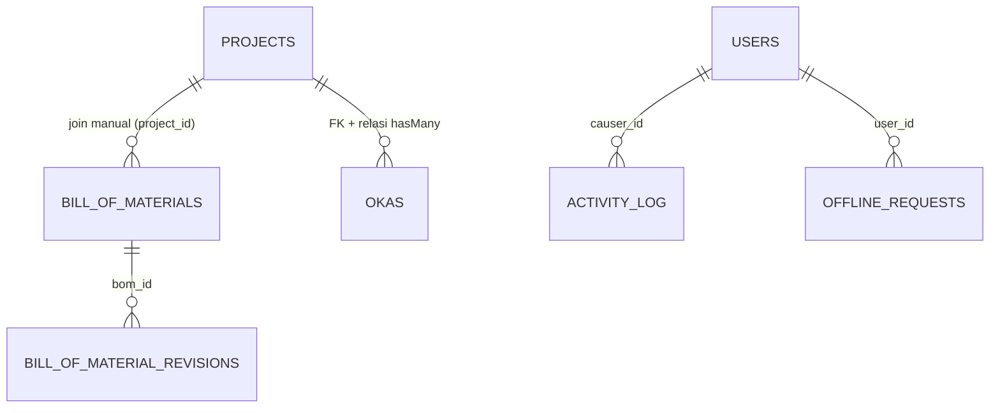

# Model dan skema data

Rangkuman dari migrasi di `database/migrations/` dan model di `app/Models/`. Semua tabel bisnis memakai UUID sebagai primary key, kecuali tabel bawaan Laravel/Spatie.

## Peta domain

| Tabel | Isi | Dipakai oleh |
| --- | --- | --- |
| `bill_of_materials` | Master dokumen BOM (nomor, nama, proyek, tanggal terbit) | Halaman Bill of Material |
| `bill_of_material_revisions` | File lampiran per versi revisi BOM | Halaman edit BOM, view/download dokumen |
| `bill_of_material_dataset` | Rekap komponen hasil import Excel BOM | Arsip import BOM (tabel penuh, selalu ditimpa) |
| `daftar_kebutuhan_materials` | Rekap kebutuhan material (17 kolom A-Q) | Dashboard Material Planning, ekspor, filter status |
| `projects` | Daftar kode proyek | Form BOM, dropdown filter, manajemen kode proyek |
| `okas` | Data OKA, terhubung ke proyek | Data pendukung proyek |
| `offline_requests` | Response idempotensi untuk request offline | Middleware `HandleClientRequestId` |
| `activity_log` | Jejak aktivitas aplikasi | Activity Log UI + audit otomatis |
| `audit_logs` | Tabel audit lama | Tidak dipakai kode aplikasi saat ini |
| `jobs`, `failed_jobs` | Antrean dan job gagal | Import BOM, status import, queue worker |

## Tabel bisnis

### `bill_of_materials`

Migrasi: `2026_09_15_055538_create_bill_of_materials_table.php:14-21`.

| Kolom | Tipe | Catatan |
| --- | --- | --- |
| `id` | uuid, PK | Diisi otomatis oleh model saat event `creating` |
| `project_id` | string, nullable | Tidak ada foreign key di migrasi; di-join manual ke `projects.id` |
| `number`, `name` | string | Wajib di form |
| `published_date` | date | Wajib |
| `created_at`, `updated_at` | timestamp | |

Model `BillOfMaterial`:

- `revisions()` : `hasMany(BillOfMaterialRevision::class, 'bom_id')` (`app/Models/BillOfMaterial.php:29-32`).
- `latestRevision()` : `hasOne(...)->latestOfMany('created_at')` (`L34-40`).
- Tidak ada relasi Eloquent `project()`; `BomController::getData()` memakai `leftJoin('projects', ...)` (`BomController.php:24-33`).

### `bill_of_material_revisions`

Migrasi: `2026_09_15_060758_create_bill_of_material_revisions_table.php:14-21`.

| Kolom | Tipe | Catatan |
| --- | --- | --- |
| `id` | uuid, PK | |
| `bom_id` | foreignUuid | Tanpa `->constrained()`, jadi tidak ada FK fisik |
| `original_name_file` | string | Nama file asli untuk ditampilkan/diunduh |
| `path_file` | string | Path relatif di disk `public` |
| `revision_version` | string, default `0` | Dipakai sebagai nama folder `rev-{versi}` |

File disimpan di `storage/app/public/bill-of-material-revisions/rev-{revision_version}/{nama-generate}`. Akses publik memerlukan `php artisan storage:link`. Tidak ada relasi `belongsTo` dari model revisi ke BOM.

### `bill_of_material_dataset`

Migrasi: `2026_09_21_000000_create_bill_of_material_dataset_table.php:11-30`.

Kolom utama: `sheet_name`, `kode_material`, `kode_material_delete`, `kode_material_stock`, `material_komponen`, `spesifikasi`, `qty_ts_series`, `uom_car`, `qty_total_series_allowance`, `qty_pr_total`, `status` (`enum valid|invalid`, default `valid`), `import_id` (terindeks), timestamps. Ada index pada `sheet_name` dan `kode_material`.

Sifat penting: setiap import yang berhasil **menghapus seluruh isi tabel** lalu mengisi ulang dari file (`BomDatasetImport.php:75-81`).

### `daftar_kebutuhan_materials`

Migrasi: `2026_11_11_034906_create_daftar_kebutuhan_materials_table.php:14-33`.

Kolom wajib: `wbs`, `sheet_asal`, `no`, `rev`, `kode_material`, `kode_material_delete`, `deskripsi_material`, `satuan`, `group`, `lot`, `kebutuhan`, `tindak_lanjut`, `no_pr`.
Kolom nullable: `kode_material_konversi`, `no_po`, `qty_pr`, `deliv_date_sap`.

Model `DaftarKebutuhanMaterial` meng-cast `kebutuhan` dan `qty_pr` menjadi `float` meskipun kolom database bertipe string. Ini penting saat menulis query agregasi atau export: export memakai nilai string mentah dari tabel.

### `projects` dan `okas`

- `projects`: UUID PK, `project_id`, `name_project`, `status`, `closed_at`.
- `okas`: UUID PK, `oka` unik, `project_id` nullable dengan FK fisik dari migrasi `2026_08_19_101100_add_foreign_keys_to_checksheet_tables.php:11-13`.
- `Project::okas()` : `hasMany(Oka::class)` (`Project.php:32-35`).

## Tabel pendukung

| Tabel | Catatan |
| --- | --- |
| `users` | UUID tidak dipakai; `nip` unik, kolom 2FA Fortify, `is_active boolean default true` |
| `roles`, `permissions`, `model_has_roles`, `model_has_permissions`, `role_has_permissions` | Spatie permission, konfigurasi standar, teams dan wildcard permission nonaktif |
| `activity_log` | Spatie activitylog + kolom wajib `feature`; index pada subject, causer, log name, batch uuid |
| `offline_requests` | `client_request_id` unik(64), `user_id` nullable terindeks, `method`, `url`, `status_code`, `redirect_url`, `response_body`, timestamps |
| `password_reset_tokens`, `sessions`, `personal_access_tokens` | Bawaan Laravel/Fortify/Sanctum |
| `jobs`, `failed_jobs` | `payload longText`; status import BOM mencari `importId` dengan `LIKE` pada payload |
| `audit_logs` | Migrasi lama, tidak ada model/controller yang memakainya |

## Hubungan lintas tabel (ringkas)

Catatan: `bill_of_materials.project_id` dan `bill_of_material_revisions.bom_id` tidak memiliki foreign key fisik. Konsistensi relasi dijaga di level aplikasi, jadi penghapusan proyek/BOM tidak otomatis membersihkan data terkait.
